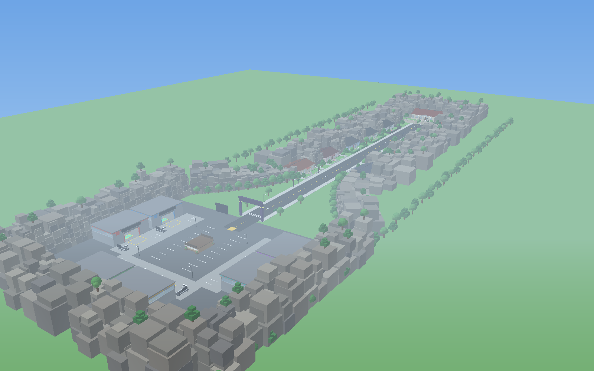
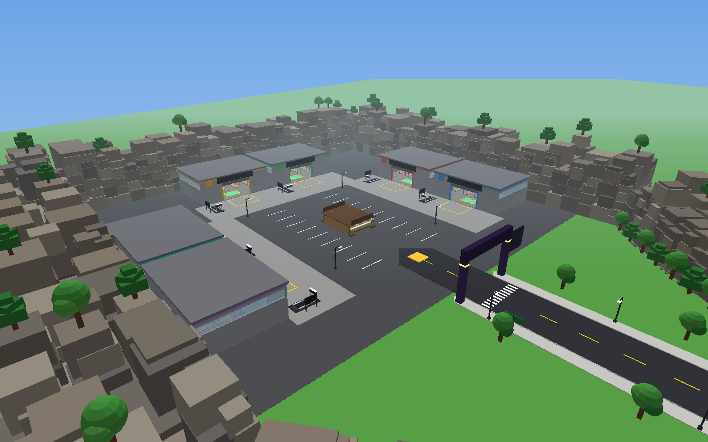
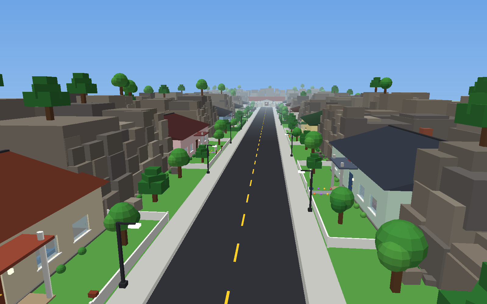
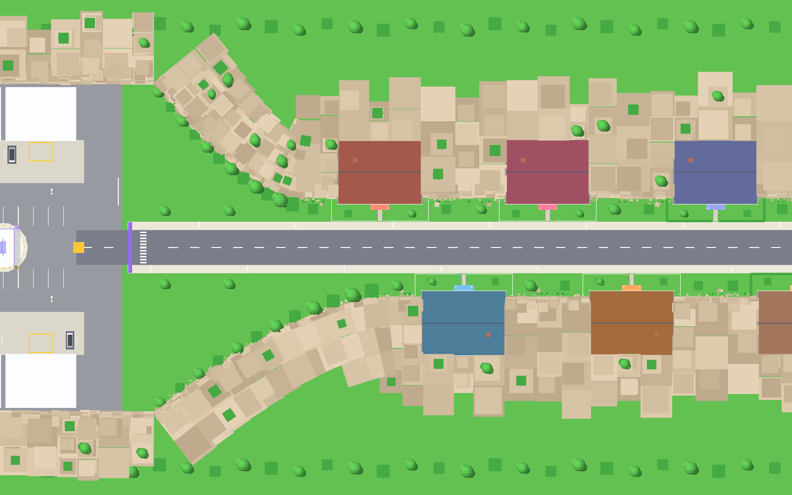
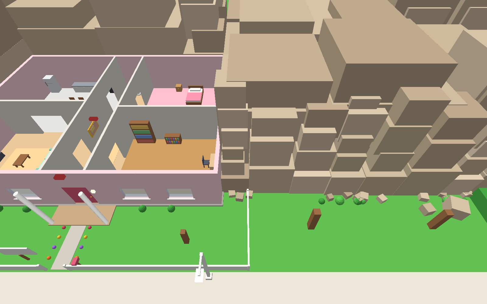
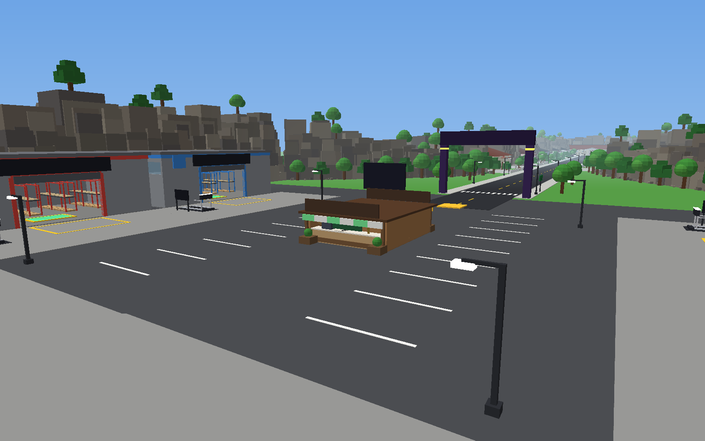
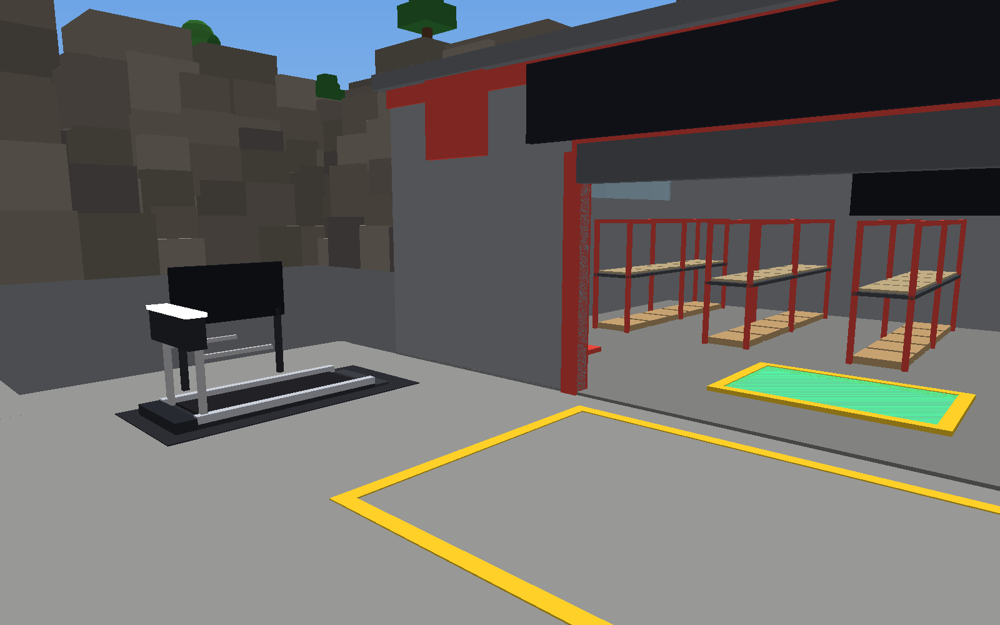
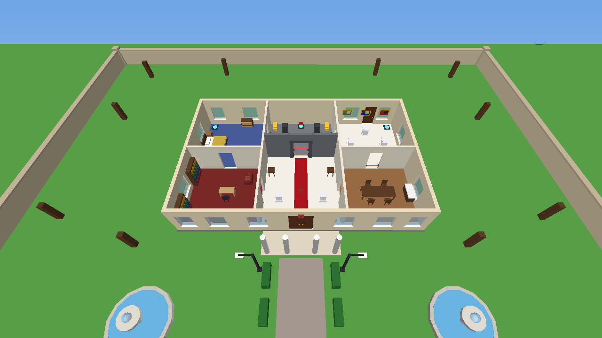

# break-and-enter

…actually called **Steal an Item** 🦝

A complete Roblox heist game. You spawn in a walled yard of garages with the market in the middle, then run down a canyon street of houses at night, pick the locks, grab the loot and outrun whatever the owner keeps inside — a cat, a puppy, a labrador, a guard dog, a home owner with a rolling pin, an off-duty officer, a wizard, a T-Rex, a squad of security bots, and a security car; the Grand Mansion at the end of the road is the town's **museum**, with a whole fleet of them parked on the drive. Stash everything in your warehouse, where it earns you cash every second — or walk up to a shelf and **take an item back off it**, or sell it on the spot at the **💰 SELL POINT** stall in the yard. Spend the money on a bigger loot bag, more warehouse space and a better treadmill. Your treadmill sits outside your warehouse and trains you even while you're AFK, until you're fast enough to outrun the fastest defenders — and when speed alone stops being enough, the **♻️ rebirth shrine** beside the market hall trades everything you have trained for a permanent boost to what your warehouse earns. Every house has its own loot, **Epic and Legendary items glow in their rarity's colour**, and the **📖 Loot Index** shows how many of the 48 items you've collected.



## ▶️ Play it in 30 seconds

1. Download **[`StealAnItem.rbxlx`](StealAnItem.rbxlx)**.
2. Double-click it, or open Roblox Studio and choose **File → Open from File…**.
3. Press **Play** (F5).

Everything is inside that one file: the town, all the scripts and the UI. Nothing needs to be installed.

> **Multiplayer test:** Studio's **Test** tab → *Clients and Servers* → pick 2+ players → **Start**.

## 🎮 How to play

| Step | What to do |
|---|---|
| 1 | You spawn in **the yard**: a parking lot ringed by six garages. One of them is yours (your name is over the door), and you always respawn inside it. |
| 2 | Run (or sprint) east down the street. Walk up to a front door and **hold E to pick the lock** (only at night!). |
| 3 | Walk up to loot and **hold E to steal** it. Your bag fills up and a loot sack appears on your back. |
| 4 | **Stealing trips the alarm!** After a short warning, the house's defenders wake up and come after you — out of the front door, through the yard and all the way back down the street. Inside the house everyone moves at the same speed; past the gate they run at their listed speed. Reach the **canyon mouth at the yard** and you're safe. If one catches you indoors, you ragdoll through the front door into the road and it slams shut. A road catch ragdolls you where you stand while the defender carries your loot home; every recovered item returns to its exact original loot spot. |
| 5 | Sprint home with the loot. The further down the street you rob, the faster they are — train on your treadmill before you take on the T-Rex. |
| 6 | Step on the **green DEPOSIT pad** in your warehouse to shelve the loot you're carrying. |
| 7 | Items on your shelves **earn cash every second**. Hold **E** on a shelf to open your **📦 STORAGE**, where you can **take an item back into your bag** or sell it for cash. |
| 8 | In a hurry? Sell your whole bag at the **💰 SELL POINT** stall in the middle of the yard. Buy upgrades at the **🛒 UPGRADE SHOP** stall opposite. Walk onto **your treadmill** outside your garage to get faster (AFK works). |
| 9 | Trained a mountain of speed? Spend it at the **♻️ SHRINE** beside the market hall for a permanent multiplier on everything your warehouse earns ([Rebirth](#-rebirth-at-the-shrine)). |

**Controls:** WASD / arrow keys to walk and run. **E** to interact, **Space** to jump or hop off the treadmill. Mobile and gamepad use the standard Roblox controls.

### 🅿️ The yard (where you spawn)

The spawn is a walled parking lot at the west end of the street. **Six garages** stand around its edges — two on each of three sides — each one with a loading dock, a yellow loading bay and a treadmill outside. A cube cliff wraps the three closed sides, and the only way out is the road east, which the cliffs follow until they meet the canyon street.

Each garage is your **warehouse**: the loading dock, the green DEPOSIT pad, your shelves and your treadmill are all there.

In the middle of the lot stand **two market stalls, back to back**: the **🛒 UPGRADE SHOP** facing the spawn and the **💰 SELL POINT** facing the garages.



### The street

All ten houses are the same roomy design (living room, kitchen, bedroom, study and a display pedestal at the end of the hall), painted differently and alternating sides of the road. Each one is built **1.35× the original plan** — about 76 × 57 studs of floor and 15 studs to the ceiling, so the rooms are genuinely big now — and they stand **further apart** down the street (78 studs between neighbours, alternating sides). Each one backs onto a rocky cliff made of different-sized cubes, so the street feels like a canyon. The further east you go, the tougher the defender and the better the loot. The Grand Mansion — now the town's **museum** — closes off the end of the road, on the same bigger plan.

Every house — the museum included — puts **five items out** at a time. Houses have four to six kinds of loot each, so a cottage shows its four and one extra copy, while the museum picks five of its six treasures for each night.

| House | Waits inside | Lockpick | Chase speed | Loot |
|---|---|---|---|---|
| 🏡 1: Maple Cottage | 🐱 a Tuxedo Cat | 0.6 s | 10 | $25–$420 |
| 🏡 2: Willow Cottage | 🐶 a Puppy | 0.6 s | 25 | $25–$420 |
| 🏡 3: Rose Cottage | 🐕 a Labrador | 0.6 s | 70 | $25–$420 |
| 🏡 4: Daisy Cottage | 🐕‍🦺 a Guard Dog | 0.6 s | 300 | $25–$420 |
| 🏠 5: Blue Oak House | 🧑 a Home Owner (rolling pin) | 1.2 s | 1,200 | $160–$1,600 |
| 🏠 6: Cedar House | 👮 an Off Duty Officer (torch) | 1.2 s | 17,500 | $160–$1,600 |
| 🏠 7: Elm Street House | 🧙 a Wizard | 1.2 s | 50,000 | $160–$1,600 |
| 🏠 8: Birch House | 🦖 a T-Rex | 1.2 s | 100,000 | $160–$1,600 |
| 🏠 9: Pine Ridge House (lasers!) | 🤖 three Security Bots | 2.0 s | 1,100,000 | $1,400–$22,000 |
| 🏠 10: Aspen House (lasers!) | 🚔 a Security Car | 2.0 s | 125,000,000 | $1,400–$22,000 |
| 🏛️ Grand Mansion **museum** (laser vault!) | 🚔 a fleet of four Security Cars | 3.0 s | 125,000,000 | $12,000–$120,000 |

**Every defender waits at its own post** — a pet bed for the animals, a chair for the people, a nest for the T-Rex, a charging pad for the bots and a marked parking bay for the cars. When you trip the alarm they wake up (eyes glowing red) and, after a short wind-up, come after you.

**The speed rule.** Inside a property *everyone* — you and them — moves at the standard Roblox speed. It is only out on the street that the numbers above apply, so a chase is a straight footrace: you keep whatever the treadmill has earned you, and they get their listed speed. (They are also quicker off the mark than you are, which is why houses 5+ are a treadmill problem, not a sneak problem.)

**They chase you home.** A defender no longer gives up at its own gate: it follows you out of the house, along the street and into the canyon mouth. The chase only ends when you reach the **yard** (past the canyon mouth), when the daytime locks the houses up, or when someone catches you. The alarm banner at the top of the screen tells you who is coming and how fast they are.

**They are physical.** A defender is a body, not a ghost: walls, shut doors, the furniture in the room and the other defenders all stop it, and it walks through the doorways rather than at the walls between them. If an opening is too small for it — the T-Rex is about 5.6 studs wide, the security cars 5.3 — it takes the roomiest way past instead of grinding in the door. Anything with legs also *walks* with a deliberately choppy stop-motion gait — six poses a second, faster or slower with the speed the body is really making — so one that is pinned against a wall stops stepping instead of moonwalking on the spot. The drones, the tracked bots and the cars hover or roll, so they are left out of it.

The two hardest houses and the museum have **blinking laser tripwires**: time your run, or jump the low beams.

Every house has **its own loot** (four to six different items: two Commons, a Rare and an Epic, plus Legendaries in the hardest houses) and puts five of them out at a time.

<details>
<summary>Spoilers: every item, house by house</summary>

| House | Common | Rare | Epic | Legendary |
|---|---|---|---|---|
| Maple Cottage | Toaster, Yarn Basket | Coffee Maker | Grandma's Jewels | |
| Willow Cottage | Desk Lamp, Teddy Bear | Cuckoo Clock | Silver Tea Set | |
| Rose Cottage | Old Radio, Cookie Jar | Piggy Bank | Antique Music Box | |
| Daisy Cottage | Snow Globe, Hair Dryer | Record Player | Crystal Cat Statue | |
| Blue Oak House | Microwave, Blender | Electric Guitar | Golden Watch | |
| Cedar House | Laptop, Smart Speaker | Flatscreen TV | Diamond Dog Collar | |
| Elm Street House | Game Console, Retro Camera | Telescope | Royal Corgi Portrait | |
| Birch House | Boombox, Vintage Fire Helmet | Saxophone | Ruby Ring | |
| Pine Ridge House | Espresso Machine, Gaming PC | Modern Art | Jewelry Box | Diamond Necklace |
| Aspen House | Robot Dog, VR Headset | Golden Trophy | Limited Sneakers | Sapphire Tiara |
| Grand Mansion | Gold Bars, Ancient Vase | Masterpiece Painting | Royal Crown | Giant Diamond, Pharaoh Mask |

</details>







### 🌙 Night and ☀️ Daytime

Heists happen at night. Every **5½ minutes** the clock at the top of the screen runs through:

- **🌙 Night, 5 minutes.** Every house is open for business.
- **☀️ Daytime, 30 seconds.** The owners come home. Every house locks up, alarms stop, lasers switch off, and anyone still on a property is shown out to the pavement (you keep whatever you're carrying). Then **every house restocks all of its loot**.

Daytime is the only time loot comes back, so a house you've emptied stays empty until the next sunrise. Use the daytime to unload, upgrade or train.

### 📖 Loot Index

Press **📖 LOOT INDEX** to see every item in the game, grouped by house, each with a little 3D picture. Items you haven't stolen yet are black silhouettes marked **???**. Steal one and it's unlocked for good: it's saved with your progress, and a toast announces each new discovery. A red badge on the button counts discoveries you haven't looked at yet, and completed houses get a ✅.

### 📦 Warehouse storage

Hold **E** on any item on your shelves — or press the **📦 STORAGE** button on the HUD — to open your warehouse storage. Every stored item is listed with its value and the cash it earns you per second, and each row has two buttons:

- **🎒 TAKE** unequips it: the item comes off the shelf and back into your bag (so you can carry it around, or move it to another plot's deposit pad).
- **💰 SELL** sells it for cash on the spot and frees the shelf.

Only you can do either of those in your warehouse; the server checks every action. Taking an item back stops it earning income until you stash it again.

### 💰 The sell point

The second market stall in the middle of the yard is run by a trader who buys loot outright. Hold **E** at the counter to open the window:

- Everything in your **bag** is listed with its price. **💰** sells one item, **🤑 SELL EVERYTHING** sells the lot.

Selling is instant cash (no shelves involved), which makes it the fastest way to fund an upgrade after a big run.



### ✨ Glowing loot

Anything **Epic or Legendary** glows in the colour of its rarity — Epic items are wrapped in a purple aura, Legendaries in gold — so you can spot the good stuff across a room, and see at a glance what's worth grabbing first. Rarity colours match the **📖 Loot Index** and the shop.

### Upgrades (at the market stall)

| Upgrade | Levels | What it does |
|---|---|---|
| 🎒 Loot Bag | 2 → 12 items | Carry more loot on foot |
| 📦 Warehouse Space | 10 → 50 slots | More shelves means more passive income |
| 🏃 Treadmill | +1 speed / 4 s → 4,096 speed/s | Your own treadmill trains you faster (see below) |

If your warehouse is full, depositing better loot automatically sells your cheapest item to make room. You can also sell — or take back — any shelf item yourself in **📦 STORAGE** (hold E on it).

### 🏃 Your treadmill

Every garage has its own treadmill out front, to the left of the loading dock. A **YOUR TREADMILL** sign floats over yours.

- **Walk onto the belt** and your character starts running by itself. Your movement keys switch off, so you can go AFK and keep getting faster.
- Press **ESCAPE**, **Space**, or **A** on a gamepad to hop off beside it. Walk back on to run again.
- A treadmill hands out **speed**: level 1 gives **+1 speed every 4 seconds**. Every upgrade **doubles the amount** and **halves the wait**, so each level trains you exactly **four times faster**: by level 8 you're getting 128 speed every 1/32 of a second, which is **4,096 a second**.
- Every whole gain rises as a cyan **`+SPEED`** number directly above your runner — there is no persistent treadmill bar covering the bottom of the screen.
- One speed point is **+1 displayed Speed** on your HUD and leaderboard. Displayed Speed is always **five times** your real movement rate: a fresh player is *Speed 80* at 16 studs/s, and *Speed 80 ➜ 81* really is 16 ➜ 16.2 studs/s.
- **There is no speed cap.** Keep running and you'll leave the whole street in the dust — even the museum's fleet only runs at 125,000,000 studs/s, which is Speed 625 million. A maxed treadmill adds 4,096 displayed Speed per second (819.2 studs/s), so it eventually gets you there. The T-Rex (100,000 studs/s) is the first real wall: Speed 500,000.
- You upgrade the treadmill itself, either at the market stall in the yard or by holding **E** at its console. Its trim gets flashier with every level, and only you can use or upgrade yours.
- Prices climb the same way the treadmill does: every level costs **four times** the last one.

| Treadmill level | 1 | 2 | 3 | 4 | 5 | 6 | 7 | 8 |
|---|---|---|---|---|---|---|---|---|
| Speed per tick | +1 | +2 | +4 | +8 | +16 | +32 | +64 | +128 |
| Time you wait for it | 4 s | 2 s | 1 s | ½ s | ¼ s | ⅛ s | 1/16 s | 1/32 s |
| Speed per second | 0.25 | 1 | 4 | 16 | 64 | 256 | 1,024 | 4,096 |
| Price | free | $300 | $1,200 | $4,800 | $19,200 | $76,800 | $307,200 | $1,228,800 |



> Roblox itself disconnects anyone who gives no input for about 20 minutes. That's a platform rule a game can't turn off, but progress is saved when they leave.

### ♻️ Rebirth (at the shrine)

Beside the market hall stands the **♻️ rebirth shrine**. It trades every speed point you have trained for a permanent boost to production.

- It costs **1,000,000 speed points** for your first rebirth, and every one after that costs **×2.5 more** (2.5M, 6.25M, 15.6M, …) — the ladder never ends.
- Each rebirth adds a permanent **+×0.1 to your production multiplier**, forever: **×1.1** after one, **×1.2** after two, **×2** after ten.
- The multiplier applies to **warehouse income *and* treadmill training**, and it is saved with your progress.
- It spends your trained speed to do it — you go back to **Speed 80** — so a rebirth is a decision about the long game, not a free upgrade. The +0.1 lands on the treadmill too, so the climb back is quicker than the last one was.
- Your **Rebirths** count is on the leaderboard with your cash, loot and speed.

| Rebirths | 1 | 2 | 3 | 5 | 10 | 15 |
|---|---|---|---|---|---|---|
| Production multiplier | ×1.1 | ×1.2 | ×1.3 | ×1.5 | ×2 | ×2.5 |
| Cost (speed points) | 1M | 2.5M | 6.25M | 39.06M | 3.81B | 372.53B |



## 💾 Saving progress

Progress saves with DataStores: cash, upgrades, speed, warehouse items and your Loot Index. Loot you're *carrying* doesn't save, so stash it! (Saves from before the Loot Index start with the items they already own unlocked.)

DataStores only work in a **published** game:

1. **File → Publish to Roblox**.
2. **Game Settings → Security → Enable Studio Access to API Services** (to test saving inside Studio).

Unpublished, the game still runs normally and shows a small "progress won't be saved" message.

> The yard has **6 garages**, so set **Max Players = 6** when you publish (Game Settings → Places). If more people join, they can still play: their loot is sold for cash at any deposit pad.

## 🛠️ Customizing

Every number lives in **[`src/shared/Config.luau`](src/shared/Config.luau)**: upgrade prices and values (including the treadmill's speed curve), each house's defender and chase speed, the chase lane and where it ends, lockpick times, how long the night and daytime last (and the sky colours), income rate and sounds.

The map is generated by `tools/map_builder.py`, where the shape of the street is easy to change: `HOUSE_SCALE` (how much bigger than the plan the houses are built), `HOUSE_PITCH` (how far apart they stand), `HOUSE_SPOTS` (how many items a house puts out at a time, the museum included) and `HOUSE_WALL_H` (how tall the rooms are). The street, the cliffs, the road and the Mansion's estate all follow those numbers.

- **The street:** `Config.Houses` lists every house in order, with its name, difficulty tier and guard. `Config.Guards` names the guards. The map builder reads both, so rebuild after changing them.
- **Add or change loot:** [`src/shared/Items.luau`](src/shared/Items.luau). Each item belongs to one house and is a small model built from parts, so no uploads are needed.
- **Guard looks:** [`src/shared/Guards.luau`](src/shared/Guards.luau) builds the cats and dogs from parts. Every dog breed is the same builder with different proportions, ears, tail and markings.
- **Skip to daytime while testing:** during Play, switch the command bar to the server and run `require(game.ServerScriptService.Server.DayNight).advance()`.
- **The yard:** the garages are laid out by `YARD_PLOTS` in [`tools/map_builder.py`](tools/map_builder.py), which also draws the cliffs around the spawn — edit them together if you move things.
- **Change the town:** the map is generated by [`tools/map_builder.py`](tools/map_builder.py). You can also edit the map directly in Studio and save the place. Just don't rebuild afterwards, because rebuilding regenerates it.
- **Sounds:** the game uses sounds that ship with Roblox so they always work. Swap in your own `rbxassetid://` IDs in `Config.Sounds`.

After editing anything in `src/` or `tools/`, rebuild the place file:

```bash
python3 tools/build_place.py        # writes StealAnItem.rbxlx (+ sourcemap.json)
```

Only Python 3 is needed (standard library only).

## 📁 Project layout

```
StealAnItem.rbxlx          ← the game (open this in Roblox Studio)
src/
  server/                  → ServerScriptService.Server
    init.server.luau         boots everything, player join/leave
    PlayerData.luau          saving/loading, attributes the UI reads, leaderstats
    Inventory.luau           carried loot and the loot sack on your back
    Plots.luau               personal warehouses, shelves, deposit pad, storage window back end
    Market.luau              the 💰 SELL POINT: list what you're carrying, sell one or all
    DayNight.luau            the 5½-minute clock: 5 min night, 30 s daytime (houses close + restock)
    Houses.luau              doors, per-house loot, alarms, chases (speeds, lanes, catching), lasers
    Treadmills.luau          personal treadmills: AFK speed training, console upgrades
    Economy.luau             income ticks + upgrade purchases
    Notify.luau              toast notifications
  client/                  → StarterPlayerScripts.Client
    init.client.luau         builds the UI, listens to the server
    Hud / Shop / Notifications / BustedScreen / UI.luau
    Storage.luau             the warehouse window: take items off the shelves or sell them
    SellPoint.luau           the trader's window: sell what's in your bag
    LootIndex.luau           the collection book (3D pictures, ??? until stolen)
    DayNight.luau            fades the sky between night and daytime
    TreadmillController.luau auto-running on your treadmill, ESCAPE / Space to hop off
    WorldEffects.luau        sirens, treadmill belts, loot auras, "your warehouse" marker
  shared/                  → ReplicatedStorage.Shared
    Config.luau  Items.luau  ItemModels.luau  Guards.luau  Format.luau
tools/
  build_place.py           builds StealAnItem.rbxlx from src/ + the generated map
  map_builder.py           procedural town (the house design, cube cliffs, Mansion, the yard + garages, roads)
  rbxlx.py                 Roblox XML place writer
  validate_place.py        checks the place file (structure + Roblox API)
  run_luau_tests.py        runs the Luau test suites
  render_preview.py        renders the preview images in docs/
tests/                     unit, server-integration and client tests (+ a mock Roblox engine)
default.project.json       optional Rojo project for live-syncing scripts
```

## 🧪 Development

The scripts are written in strict-mode Luau and checked against the real Roblox API.

```bash
python3 tools/build_place.py                                   # build the place
python3 tools/validate_place.py --database database.json      # check every class/property/enum
python3 tools/run_luau_tests.py --database database.json      # 69 tests (needs the `luau` CLI)
luau-lsp analyze --settings .vscode/settings.json --platform roblox \
  --sourcemap sourcemap.json --definitions=@roblox=globalTypes.d.luau src   # type-check
```

- `database.json` is Rojo's API dump ([rbx-dom](https://github.com/rojo-rbx/rbx-dom/blob/master/rbx_dom_lua/src/database.json)). `luau` and `luau-lsp` come from their GitHub releases.
- The integration tests run the real server and client scripts against a small mock of the Roblox engine. That mock loads the real generated map and rejects invalid properties, just like Roblox does. They play through joining, lockpicking, stealing (and discovering items), getting busted by a defender, escaping, the speed change at the property line, being chased down the street to the canyon mouth, depositing, earning, upgrading, AFK treadmill training (including hopping off with Space), managing storage (taking an item off a shelf, selling it, a full-bag refusal), selling carried loot at the sell point, the Loot Index UI, the loot auras, a full daytime (houses locking, everyone shown out, every house restocking), and saving then loading.
- **Rojo (optional):** open `StealAnItem.rbxlx` in Studio, run `rojo serve`, and connect the Rojo plugin to live-sync `src/` while you edit.
